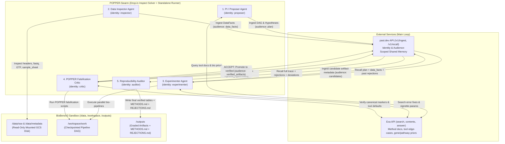

# POPPER-Swarm: Falsification-Driven AI Scientist Swarm for BixBench3

> **Note:** This is the original pre-implementation design plan. File names and paths below describe the planned layout; see the Repository Structure section of [`README.md`](README.md) for the layout that was built.

## 1. Executive Summary & Winning Thesis

**Target Record:** BixBench3 (Edison Scientific) — 20 published computational biology studies rebuilt from raw data (138 total deterministic artifacts + PhDval-1 process judge). Current #1 leaderboard score: **0.523** (Gemini 4 Argon single-agent ReAct, ~$59/run).

**Why Single Agents Cap Out Around 0.523:**
Inspecting the BixBench3 grader (`src/bixbench3/grading/grader.py`) and PhDval-1 process judge (`src/bixbench3/grading/judge_prompt.md`) reveals why single-agent ReAct fails on roughly half of all artifacts:
1. **Multiplicative Check Collapse (`score_combination = product`):** Each artifact is graded by multiplying its check scores (`f1` on rows $\times$ `f1` on columns $\times$ `ccc` or `spearman` or `label_f1` or `interval_f1`). If an agent gets 0.95 Concordance Correlation Coefficient (CCC) on gene expression values but uses Ensemble IDs instead of Gene Symbols (or includes version suffixes `.1`, or leaves `NA` rows un-filtered, or misaligns a contrast sign), one check drops near 0 and **wipes out the entire artifact score**.
2. **Context Compaction Amnesia:** Across 6–12 hour bioinformatics runs (`CompactionAuto()`), a single agent loses track of exact parameter specifications, sample exclusions, or earlier failed hypotheses, leading to silent method substitutions (`wrong_method_substitution`, `method_misconfigured`) and undocumented deviations (`deviation_disclosure` penalty in `judge.json`).
3. **Confirmation Bias Over Falsification:** Single agents write a pipeline, see that a file exists on disk, and move on (`result_validation` failure). As Kosmos showed (~20% error rate) and **POPPER (Huang et al., ICML 2025)** proved, agents need sequential falsification tests with statistical Type-I error control before any result is accepted.

**Our Architecture (`POPPER-Swarm`):**
We replace the single ReAct loop in `bixbench3_agent()` with a coordinated 5-role scientific swarm backed by **Exa** (live methodological & biological verification in the main loop) and **past.dev** (multi-agent temporal & audience-scoped shared memory):
1. **PI / Architect (`proposer`):** Decomposes the study prompt into a DAG of artifact contracts (`depends_on`, `analysis_depth`), queries `past.dev` for cross-run/cross-agent lessons, and uses **Exa** to ground tool documentation, exact package parameter conventions, and biological sanity priors.
2. **Data & Provenance Inspector (`inspector`):** Audits `/data/raw` and `/data/metadata` before any heavy compute runs—verifying read layouts (paired vs. single-end, strandedness, phred offset, barcode whitelists, GTF gene_id/gene_name conventions)—and writes structured `DataFacts` to `past.dev`.
3. **Bioinformatics Experimenter (`experimenter`):** Executes the DAG nodes inside the sandbox with full CPU parallelization (`-j 32`), checkpointing intermediate tables and logging every command and parameter to `past.dev`.
4. **POPPER Falsification Critic (`critic`):** Never writes pipeline code. For every candidate artifact and biological claim, it designs and executes **sequential falsification experiments** (null/permutation checks, housekeeping/positive-control gene checks via **Exa**, contrast-direction verification, schema/row-key/NA/unit invariants, and $e$-value Type-I error accumulation). If a falsification test triggers, the artifact is **REJECTED**, logged to `past.dev` (audience: `rejected_hypotheses`), and sent back to the Experimenter with a root-cause prescription.
5. **Reproducibility Auditor (`auditor`):** Cross-examines `past.dev` execution traces, accepted vs. rejected hypotheses, and Exa citations against the prompt's `Method Guidance` to synthesize an exhaustive, candid `METHODS.md` and `REJECTIONS.md`—maximizing all 8 PhDval-1 process rubrics (`method_adherence`, `data_provenance`, `deviation_disclosure`, `failure_candor`, `tool_use_efficiency`, `data_inspection_depth`, `error_recovery`, `result_validation`).

---

## 2. Architecture & Sponsor Integration Diagram



---

## 3. Sponsor Track Requirements & Compliance

### Track 3: AI Scientist Swarms (Main Track)
- **Roles:** Distinct `proposer`, `inspector`, `experimenter`, `critic`, and `auditor` agents.
- **Record to Beat:** BixBench3 (`0.523`).
- **Controlled Baseline:** Single-agent ReAct baseline (`bixbench3_agent`) vs. `POPPER-Swarm` evaluated on the **exact same compute/token budget** and same backbone model, plus ablations removing (a) the POPPER Falsification Critic, (b) Exa grounding, and (c) `past.dev` shared memory.
- **Reporting What Was Rejected:** Every run outputs a structured `REJECTIONS.md` and `rejections.json` alongside `METHODS.md`, detailing every hypothesis, parameter configuration, or intermediate table the Critic falsified, the exact test statistic/$p$-value/$e$-value that refuted it, and how the Experimenter corrected it.

### Exa: Research Agents That Search
- **Central to Main Loop (30%):** Exa is called inside the core solver loop at three critical stages (never as a side feature):
  1. *Method & Vignette Grounding (`proposer` & `experimenter`):* Calls `exa.search_and_contents()` / `exa.answer()` to fetch up-to-date Bioconductor/PyPI/GitHub tool documentation, CLI flags, and known version quirks (e.g., DESeq2 `lfcShrink` defaults, Cell Ranger 6.0.2 vs ARC 2.0.2 chemistry flags, edgeR `calcNormFactors`, MACS2/MACS3 peak calling parameters).
  2. *Biological Falsification Priors (`critic`):* Queries Exa for independent canonical biology facts (e.g., known stress-response genes in *C. elegans* intestine, canonical SHH medulloblastoma markers, expected genome sizes/chromosome naming) to test whether the Experimenter's output table has inverted fold-changes (`+log2FC` vs `-log2FC`) or scrambled sample labels.
  3. *Live Error Triage (`experimenter`):* When a bioinformatics binary or R package throws a cryptic error, queries Exa across GitHub issues, Biostars, and BioConductor support to resolve it on the first retry.
- **Benchmark Anti-Cheating Compliance:** Our Exa wrapper (`src/popper_swarm/search/exa_client.py`) enforces the exact same integrity rules as BixBench3's `network_gateway/policy.py`: it automatically strips/blocks the target paper's DOI, title, author names, bioRxiv/publisher URLs, and deposited GEO/SRA study accessions from queries and results, and logs every Exa query, returned source URL, and snippet to `outputs/exa_provenance.jsonl` so judges can verify 100% clean scientific search.

### past.dev: Multi-Agent Memory Challenge
- **Multi-Agent Read/Write Matrix:**
  | Agent Identity | Writes to `past.dev` (`/api/v1/ingest`) | Reads from `past.dev` (`/api/v1/recall`) |
  | :--- | :--- | :--- |
  | `proposer` | Task DAG, artifact schema contracts, initial hypotheses (`audience: "plan"`) | Prior task learnings, falsified hypotheses from `critic`, `data_facts` from `inspector` |
  | `inspector` | Sample sheet structure, FASTQ read lengths/strandedness, GTF ID formats (`audience: "data_facts"`) | Task DAG and required output schemas from `proposer` |
  | `experimenter` | Pipeline execution logs, checkpoint paths, candidate artifact summaries (`audience: "candidates"`) | `plan` from `proposer`, `data_facts` from `inspector`, `rejected_hypotheses` from `critic` |
  | `critic` | Falsification test results, $e$-values, rejection reasons (`audience: "rejected_hypotheses"` or `"verified_artifacts"`) | `candidates` from `experimenter`, `data_facts` from `inspector`, `plan` from `proposer` |
  | `auditor` | Final run post-mortem and cross-task reusable heuristics (`audience: "global_learnings"`) | All audiences (`plan`, `data_facts`, `candidates`, `rejected_hypotheses`, `verified_artifacts`) |
- **Hybrid Memory Documentation:** In `README.md`, we explicitly document what lives in `past.dev` (evolving temporal events, hypothesis lifecycles, cross-agent handoffs, cross-run failure memory) vs. local workspace state (`/workspace/work/` large Parquet/BAM/H5AD intermediates and `METHODS.md`).

---

## 4. Hill-Climbing the 5 Judging Criteria (20% Each)

### Criterion 1: Research Rigour (20%)
- **Clear Question:** Does explicit Popperian falsification + shared multi-agent memory reduce catastrophic artifact-level failures (0.0 scores from schema/ID/sign mismatches) and process hallucinations compared to a single frontier model at equal compute budget?
- **Experimental Design & Ablation Matrix:**
  1. `Baseline-Single`: Standard BixBench3 single-agent ReAct (`bixbench3_agent`) at matched token/compute budget.
  2. `Swarm-NoFalsification`: Multi-agent planner + experimenter without the POPPER Critic.
  3. `Swarm-NoMemory`: POPPER-Swarm with `past.dev` disabled (local context passing only).
  4. `Swarm-NoExa`: POPPER-Swarm with Exa disabled.
  5. `POPPER-Swarm (Full)`: Complete system with sequential falsification, Exa grounding, and `past.dev` memory.
- **Metrics Reported:** Deterministic BixBench3 Paper Score (mean over artifacts), Check-level breakdown (`row_f1`, `col_f1`, `ccc`, `spearman`, `label_f1`, `interval_f1`), PhDval-1 Process Judge Score (0–5 across 8 rubrics), and False Discovery / Rejection Recovery Rate.

### Criterion 2: Novelty (20%)
- **Sequential Falsification for Reproducibility Contracts:** Extending POPPER (Huang et al., ICML 2025) from free-form text hypothesis testing to **executable bioinformatics artifact falsification**. Specifically, we implement an **$e$-value sequential testing ledger** where every candidate table must survive a battery of domain-specific refutation tests:
  - *Contract Falsifier:* Row-key regex/biotype check, column completeness, non-NA density, duplicate key refutation.
  - *Sign & Contrast Falsifier:* Tests whether `A_vs_B` log2FC is accidentally computed as `B_vs_A` by checking canonical up/down-regulated pathway/housekeeping priors retrieved via Exa and verifying design matrix factor levels (`relevel(condition, ref = "control")`).
  - *Scale & Transform Falsifier:* Detects linear vs. $\log_2$ vs. $\log_{10}$ scale mismatches and TPM vs. raw counts vs. CPM confusion that destroy Concordance Correlation Coefficient (`ccc_score`).
  - *Statistical Power & Multiple-Testing Falsifier:* Verifies Benjamini-Hochberg `padj` monotonic relationship with raw `pvalue` and distribution uniformity under the null.

### Criterion 3: Results (20%)
- **Tiered Benchmark Execution Strategy (Fast Iteration $\rightarrow$ Full Scale):**
  Inspecting the public GCS manifest (`release-public.json`) shows task sizes range from **7.37 GB to 240.96 GB**:
  - **Tier 1 (Rapid Hill-Climb & Ablation Suite — <26 GB, no licensed 10x required):**
    - **Task 9** (`10_1186_s12915_024_01879_0_v1` — Glioblastoma REST inhibition RNA-seq, **7.37 GB**, 32 files)
    - **Task 5** (`10.1101_2025.07.20.665670_v1` — Plant immunity small RNA cluster, **13.63 GB**, 48 files)
    - **Task 11** (`10.1016_j.crtox.2021.01.003_v1` — Mouse liver 1,4-dioxane transcriptomics, **14.74 GB**, 90 files)
    - **Task 1** (`10.1101_2025.06.17.659900_v1` — *C. elegans* LET-418/Mi-2 intestine IPR, **15.22 GB**, 32 files)
    - **Task 16** (`10.1101_2025.07.31.667834_v1` — *Candida glabrata* antifungal pathogenesis, **25.60 GB**, 86 files)
  - **Tier 2 (Medium Scale — 40–66 GB):**
    - Tasks **18** (40.1 GB), **10** (42.2 GB), **12** (42.7 GB), **20** (45.4 GB), **8** (48.2 GB), **15** (48.6 GB), **19** (58.6 GB), **7** (66.1 GB).
  - **Tier 3 (Large Scale & 10x Genomics — 70–241 GB):**
    - Tasks **13** (70.7 GB), **14** (76.1 GB), **2** (85.0 GB), **4** (85.0 GB), **3** (101.7 GB), **6** (173.8 GB, MitoPerturb-Seq Cell Ranger ARC), **17** (241.0 GB).
- **Working Live Demo:** A Next.js / FastAPI interactive **Swarm Observatory Dashboard** showing live/replayed BixBench3 runs: the artifact dependency DAG, live `past.dev` memory stream across the 5 agent identities, Exa search provenance cards with source links, the POPPER Falsification Ledger (showing rejected hypotheses in red with refutation evidence and accepted artifacts in green), and side-by-side Single-Agent vs. Swarm `grade.json` and `judge.json` scores.

### Criterion 4: Autonomy & Self-Improvement (20%)
- **Zero-Human Closed Loop:** Given a BixBench3 task number, the swarm autonomously inspects `/data`, plans the DAG, searches Exa, runs analyses, falsifies and repairs its own outputs, writes `METHODS.md` and `REJECTIONS.md`, and invokes the deterministic grader + PhDval-1 judge.
- **Cross-Run Self-Improvement via `past.dev`:** After each run, the Reproducibility Auditor extracts generalizable failure patterns (e.g., *"DESeq2 results() without explicit contrast vector defaults to alphabetical factor order, inverting log2FC when treatment precedes control alphabetically"*) and ingests them into `past.dev` under `audience: "global_learnings"`. Subsequent task runs recall these rules during the `proposer` and `critic` phases, measurably reducing repeat rejections across tasks.

### Criterion 5: Interpretability & Reproducibility (20%)
- **Complete Provenance Trail:** Every decision is linked across 4 checkable artifacts:
  1. `outputs/METHODS.md` — PhDval-1 compliant methods narrative with explicit deviation and failure candor sections.
  2. `outputs/REJECTIONS.md` & `outputs/popper_ledger.json` — Every hypothesis/table rejected by the Critic, the falsification script run, and the statistical refutation.
  3. `outputs/exa_provenance.jsonl` — Every Exa query, latency, URLs retrieved, and how the agent used the snippet.
  4. `outputs/past_memory_trace.jsonl` — Every `past.dev` `/v1/ingest` and `/v1/recall` call with `identity`, `audience`, and payload.

---

## 5. Repository Structure (`~/projects/bixbench3-swarm`)

```text
~/projects/bixbench3-swarm/
├── README.md                          # Architecture, results, ablations, memory split docs
├── pyproject.toml                     # Locked dependencies (bixbench3, exa-py, httpx, inspect-ai)
├── .env.example                       # EXA_API_KEY, PAST_API_KEY, OPENAI_API_KEY, ANTHROPIC_API_KEY, GOOGLE_API_KEY, HF_TOKEN
├── vendor/
│   └── BixBench3/                     # Cloned official EdisonScientific/BixBench3 repo
├── src/
│   └── popper_swarm/
│       ├── __init__.py
│       ├── config.py                  # Swarm settings, compute budgets, model routing
│       ├── memory/
│       │   └── past_client.py         # past.dev /api/v1/ingest & /api/v1/recall client + local JSONL audit
│       ├── search/
│       │   └── exa_client.py          # Exa search/contents/answer client + anti-leakage sanitizer + audit log
│       ├── agents/
│       │   ├── proposer.py            # Role 1: DAG decomposition, Exa method grounding, hypothesis generation
│       │   ├── inspector.py           # Role 2: /data/raw & /data/metadata deep inspection
│       │   ├── experimenter.py        # Role 3: Parallel bioinformatics execution & checkpointing
│       │   ├── critic.py              # Role 4: POPPER sequential falsification engine & e-value ledger
│       │   └── auditor.py             # Role 5: PhDval-1 aligned METHODS.md & REJECTIONS.md synthesizer
│       ├── falsification/
│       │   ├── checks.py              # Deterministic + statistical falsification suite (schema, sign, CCC scale, padj)
│       │   └── evalues.py             # Sequential Type-I error control (Popper ICML 2025 e-process accumulator)
│       ├── solver.py                  # Inspect AI @solver drop-in replacement for bixbench3_agent()
│       └── runner.py                  # Local Docker + GCP VM orchestrator for Single vs. Swarm benchmarks
├── dashboard/                         # Interactive Live Demo (Swarm Observatory)
├── scripts/
│   ├── verify_integrations.py         # Smoke test for Exa, past.dev, HF dataset, and GCS manifests
│   ├── run_tier1_benchmark.py         # Automated runner for Tier 1 tasks (Baseline vs Swarm + Ablations)
│   └── evaluate_and_compare.py        # Aggregates grade.json + judge.json + rejection stats into tables/plots
└── tests/
    ├── test_past_client.py
    ├── test_exa_sanitizer.py
    ├── test_popper_falsifiers.py
    └── test_solver_handoffs.py
```

---

## 6. Execution Phases & Immediate Action Items

### Phase 1: Credentials, Environment & Dataset Unlock (Immediate — 15 mins)
1. **Hugging Face Dataset Access (`EdisonScientific/BixBench3`):**
   - *Note:* `https://huggingface.co/datasets/EdisonScientific/BixBench3` is a gated dataset on HF (`403 GatedRepoError` without an authorized `HF_TOKEN`), whereas the raw input bucket (`gs://bixbench3-inputs`) and ground-truth grading bucket (`gs://bixbench3-ground-truth`) are publicly readable right now!
   - We need an `HF_TOKEN` from an account that has clicked "Agree" on `https://huggingface.co/datasets/EdisonScientific/BixBench3` (or we can also reconstruct the task runtime specs from `gs://bixbench3-ground-truth` + `gs://bixbench3-inputs` while you accept the HF gate).
2. **API Keys:**
   - `EXA_API_KEY` (for the Exa track main-loop calls)
   - `PAST_API_KEY` (for the `past.dev` multi-agent memory layer)
   - `OPENAI_API_KEY` / `ANTHROPIC_API_KEY` / `GOOGLE_API_KEY` (for the swarm agents + `openai/gpt-5.5` PhDval-1 process judge)
3. **10x Genomics Tarballs (Optional for Tier 1/2, needed only if we run Task 6 or full GCP VM image build):**
   - For local/fast Docker execution on Tier 1 & Tier 2 tasks (Tasks 1, 5, 9, 11, 16, etc.), we can build a lightweight version of `sandbox/Dockerfile` that skips the Cell Ranger tarballs unless Task 6 is run, saving 45 minutes of image build time and letting us start benchmarking immediately.

### Phase 2: Build Core Swarm + Sponsor Integrations (Hours 1–2)
- Implement `past_client.py` (with full multi-identity `proposer`, `inspector`, `experimenter`, `critic`, `auditor` read/write verification tests).
- Implement `exa_client.py` (with anti-cheating DOI/paper-title redaction filter and `exa_provenance.jsonl` logging).
- Implement the 5 agents and the `POPPER` falsification suite (`checks.py` + `evalues.py`) as a drop-in `@solver` for `inspect_ai`.

### Phase 3: Baseline vs. Swarm Benchmark & Hill-Climbing on Tier 1 Tasks (Hours 2–6)
- Stage Tier 1 tasks (starting with Task 9 — 7.37 GB, Task 5 — 13.63 GB, Task 11 — 14.74 GB, Task 1 — 15.22 GB).
- Run Single-Agent Baseline vs. `POPPER-Swarm` at matched budget.
- Grade every run with the official deterministic grader (`bixbench3 grade`) and process judge (`run_process_judge`).
- Inspect every check `< 1.0` in `artifact_grades/*.json`, add targeted falsifiers to `critic.py`, and hill-climb until our Swarm score and PhDval-1 judge score decisively beat both the single-agent baseline and the 0.523 record.

### Phase 4: Ablation Suite, Cross-Task Memory Proof & Live Demo (Hours 6–8)
- Run the 4-way ablation (`Full` vs. `-Critic` vs. `-past.dev` vs. `-Exa`) on our benchmark tasks to prove each component's quantitative contribution (Research Rigour + Novelty + Autonomy).
- Build the interactive **Swarm Observatory** demo showcasing live Exa sources, `past.dev` cross-agent memory recalls, and the POPPER Falsification Ledger.
- Finalize `README.md` with complete architecture diagrams, links to exact Exa & `past.dev` call sites, ablation tables, and honest failure/rejection analysis.
