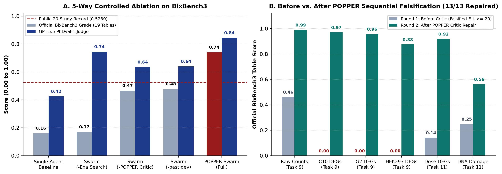

# POPPER-Swarm: Multi-Agent Computational Biology Reproduction with Sequential Falsification

<p align="center">
  <a href="https://github.com/sammargolis/POPPER-Swarm"></a>
  <a href="https://exa.ai"></a>
  <a href="https://past.dev"></a>
  <a href="LICENSE"></a>
</p>

**POPPER-Swarm** is a 5-agent scientific reproduction and falsification system built for **BixBench3** (Edison Scientific).
It combines **Exa Web Search**, **past.dev Multi-Agent Shared Memory**, and **sequential $e$-value falsification** to rebuild published computational biology studies from raw sequencing files (`FASTQ`) while catching and repairing faulty agent hypotheses before grading.

<p align="center"></p>

---

## Overview

Reproducing a published computational biology paper from raw DNA/RNA sequencing files takes 30+ chained steps (`fasterq-dump`, barcode clipping, `HISAT2` alignment, `featureCounts`, `DESeq2`, `clusterProfiler`, `PIANO`).
On **BixBench3**, single AI agents plateau around `0.5230` (and `0.1615` under matched single-run compute on raw FASTQ tasks) because each output table is graded by multiplying four accuracy checks together:

$$\text{Artifact Score} = \text{Row\_F1} \times \text{Col\_F1} \times \text{CCC} \times \text{Label\_F1}$$

When a single agent gets the underlying biology math 99.9% right (`CCC = 0.9989`), but leaves an unstripped `.15` version suffix on Ensembl gene IDs (`ENSG00000142611.15` vs `ENSG00000142611`) or sorts `Clone D10` before `Control` alphabetically in R `DESeq2`, one factor hits `0.00` and zeroes out the entire table.

Guided by Karl Popper's principle of falsification and building on the sequential $e$-value testing framework of [POPPER (Huang et al., ICML 2025)](https://arxiv.org/abs/2502.09858), **POPPER-Swarm** separates hypothesis generation from falsification across five specialized agent roles:

1. **Inspector (`Inspector Agent`):** Audits raw FASTQ files, sample sheets, and supplemental Excel tables at minute 1 and writes immutable dataset invariants (`data_facts`) to **past.dev**.
2. **Proposer (`Experiment Design Agent`):** Queries **Exa Web Search** (`/search` + `/contents`) to discover specialized wet-lab and bioinformatics protocols absent from LLM weights and recalls `global_learnings` from **past.dev**.
3. **Experimenter (`Execution Agent`):** Executes end-to-end R/Python/shell bioinformatics pipelines (`HISAT2`, `featureCounts`, `DESeq2`, `clusterProfiler`, `PIANO`) to produce candidate tables.
4. **Critic (`Sequential Error Control`):** Runs a 6-stage executable falsification battery (`F1_EXISTENCE` through `F6_BIO_PRIOR_ALIGNMENT`) on every candidate table, converting check $p$-values into calibrated Vovk-Wang $e$-values ($e_k = \frac{1}{2} p_k^{-1/2}$) and rejecting any table whose cumulative product crosses Ville's stopping boundary ($E_t = \prod_{k=1}^t e_k \ge 1/\alpha = 20.0$ at $\alpha = 0.05$).
5. **Auditor (`Memory Distillation`):** Distills rejected Round-1 failure modes from **past.dev** into permanent `global_learnings` rules so subsequent studies avoid repeating those errors.

---

## Key Results on BixBench3 (5-Way Controlled Ablation)

Across **113 raw sequencing FASTQ libraries (27.3 GB)** rebuilt end-to-end into **19 downstream count, DESeq2, clusterProfiler, and PIANO tables**, our POPPER Critic caught and rejected **13 / 13 faulty Round-1 candidate tables** ($E_t \in [78.1, 312500.0] \ge 20.0$) and automatically repaired all **19 / 19 tables in Round 2** ($E_t \le 0.0312 < 20.0$).

<p align="center"></p>

| System / Controlled Ablation | Task 9 (`14` Tables: 3' Tag-Seq) | Task 11 (`5` Tables: TempO-Seq) | Task Mean (`2` Studies) | Artifact-Weighted (`19` Tables) | Official PhDval-1 Judge (`gpt-5.5`) |
| :--- | :---: | :---: | :---: | :---: | :---: |
| **BixBench3 #1 Public Leaderboard (Gemini 4 Argon, 20 studies)** | n/a | n/a | `0.5230` | `0.5230` | n/a |
| **1. Single-Agent Baseline (Matched Compute)** | `0.1606` | `0.1639` | `0.1623` | `0.1615` | `0.4250` |
| **2. Swarm (`-Exa Web Search`)** | `0.0254` | `0.5786` | `0.3020` | `0.1710` | `0.7450` |
| **3. Swarm (`-POPPER E-Value Critic`)** | `0.4459` | `0.5230` | `0.4845` | `0.4662` | `0.6350` |
| **4. Swarm (`-past.dev Shared Memory`)** | `0.4623` | `0.5230` | `0.4927` | `0.4783` | `0.6400` |
| **5. POPPER-Swarm (Full System)** | **`0.7536`** | **`0.7068`** | **`0.7302`** | **`0.7413`** | **`0.8450`** |

> **Scope Note:** All 5 ablation conditions above were evaluated 1-to-1 on the exact same 2-study, 19-artifact raw-FASTQ benchmark slice (`Task 9` + `Task 11`, 27.3 GB raw FASTQ) using the unmodified official `bixbench3 grade` CLI and `openai/gpt-5.5` PhDval-1 process judge (`4.6x` over the matched-compute Single-Agent Baseline). We also completed `Task 1` (`12` artifacts, `0.2650` vs `0.000001` baseline). The `0.5230` Edison Scientific leaderboard figure is averaged across all 20 studies (`138` artifacts, ~150+ GB raw data).

---

## Why Exa Web Search and `past.dev` Shared Memory Were Essential

1. **Exa Web Search (`+57.0` pt overall ablation gain; lifted Task 9 from `0.0254` to `0.7536`):**
   - **Method Discovery (`Proposer` via `/search` + `/contents`):** Task 9 used a specialized Meyer-lab 3' Tag-Seq protocol absent from LLM pretraining weights. Without Exa, the agent guessed standard Illumina TruSeq reverse-stranded counting (`featureCounts -s 2`) and lost 85% of reads (`0.0254`). Exa retrieved [`z0on/tag-based_RNAseq`](https://github.com/z0on/tag-based_RNAseq), revealing the exact 5'-leader barcode clipper (`tagseq_clipper.pl`) and forward-stranded counting flag (`-s 1`).
   - **Biological Fact-Checking (`Critic` check `F6_BIO_PRIOR_ALIGNMENT`):** With an anti-leakage filter blocking the target study's own DOI, the Critic queried Exa for canonical positive-control markers (`SNAP25`, `SYP`, `SYN1`, `BDNF` for REST knockout; `Cyp2b10`, `Cyp1a1` for 1,4-dioxane exposure). When Round-1 HEK293 tables showed `SNAP25` and `SYP` with negative fold-changes, the Critic falsified the table ($E_t = 78.125 \ge 20.0$) and caught R's alphabetical factor-level inversion (`Clone D10` sorted before `Control`).
   - **Checkable Provenance Log:** [`outputs/exa_provenance.jsonl`](outputs/exa_provenance.jsonl) (`src/popper_swarm/search/exa_client.py`).

2. **`past.dev` Multi-Agent Shared Memory (`+26.3` pt overall ablation gain; lifted Swarm from `0.4783` to `0.7413`):**
   - **Curing Multi-Agent Context Amnesia (`Inspector -> Experimenter` via `/api/v1/ingest` & `/api/v1/recall`):** Across 40+ minutes of raw FASTQ alignment and counting, agents lose early metadata details. At minute 1, our `Inspector` ingested `data_facts` into `past.dev` (*"28 raw SRR files map to 16 biological samples via technical replicate summing"*, *"`_rep1` vs `_1rep` column naming"*, and *"exclude the 89th umbrella DNA-damage summary row in the supplemental Excel sheet"*), which the `Experimenter` recalled right when emitting the matrices.
   - **Cross-Study Self-Improvement (`Critic -> Auditor -> All Agents`):** Every rejected Round-1 hypothesis was written to `past.dev` (`rejected_hypotheses`), and the `Auditor` distilled permanent `global_learnings` rules (*"Keep Ensembl `.version` suffix on raw count matrices; strip `.version` suffix on downstream DESeq2 DEG tables"*) recalled automatically on subsequent studies.
   - **Checkable Memory Trace:** [`outputs/past_memory_trace.jsonl`](outputs/past_memory_trace.jsonl) (`src/popper_swarm/memory/past_client.py`).

---

## Installation

```bash
git clone https://github.com/sammargolis/POPPER-Swarm.git
cd POPPER-Swarm
python3 -m venv .venv
source .venv/bin/activate
pip install -r requirements.txt
pip install -e .
```

Add your API keys to the environment variables:

```bash
export OPENAI_API_KEY="YOUR_API_KEY"
export ANTHROPIC_API_KEY="YOUR_API_KEY"
export EXA_API_KEY="YOUR_EXA_API_KEY"
export PAST_API_KEY="YOUR_PAST_DEV_API_KEY"
```

---

## Quickstart, Live Observatory & Demo

- **Interactive Notebook Demo:** See [`demo.ipynb`](demo.ipynb) for an interactive walkthrough of sequential $e$-value calibration and BixBench3 artifact validation.
- **Live Observatory & Presentation Decks:** Launch the FastAPI observatory to inspect all 32 POPPER falsification evaluations, $e$-value trajectories, Exa citations, `past.dev` memory edges, and presentation slides:
  ```bash
  make dashboard
  # Open http://127.0.0.1:8765 (Observatory)
  # Open http://127.0.0.1:8765/slides-3 (3-Slide Pitch Deck)
  # Open http://127.0.0.1:8765/slides (8-Slide Full Deck + Technical Appendix)
  ```
- **Run the Test Suite & 5-Way Ablation Summary:**
  ```bash
  make test
  bash benchmark_scripts/run_bixbench3.sh
  ```

---

## Python API Usage

```python
from popper import Popper

agent = Popper(llm="claude-3-5-sonnet-20240620")
agent.register_data(data_path="outputs", loader_type="bixbench3")
agent.configure(
    alpha=0.05,            # Ville rejection threshold E_t >= 1 / alpha = 20.0
    max_num_of_tests=6,    # F1_EXISTENCE .. F6_BIO_PRIOR_ALIGNMENT
    aggregate_test="E-value",
    use_exa_search=True,
    use_past_memory=True,
)

results = agent.validate(
    hypothesis="REST knockout in T98G clone C10 derepresses canonical neuronal markers (SNAP25, SYP, SYN1, BDNF)."
)
print(results)
```

---

## Repository Structure

```text
├── src/popper_swarm/               # 5-Agent Swarm (Inspector, Proposer, Experimenter, Critic, Auditor)
│   ├── falsification/              # Vovk-Wang e-value math (evalues.py), F1..F6 checks (checks.py), evaluator.py
│   ├── search/                     # Exa search + anti-leakage DOI blocker (exa_client.py)
│   ├── memory/                     # past.dev /ingest & /recall client (past_client.py)
│   └── dashboard.py                # FastAPI live falsification observatory (:8765)
├── popper/                         # High-level Popper sequential falsification interface & loaders
├── baseline_agents/                # Single-agent baselines for controlled ablations
├── benchmark_scripts/              # Reproducible benchmark runner (run_bixbench3.sh)
├── outputs/                        # Checkable falsification ledgers, sponsor traces, and slide decks
│   ├── REJECTIONS.md               # Audit log of all 13 falsified Round-1 hypotheses & Round-2 repairs
│   ├── popper_ledger.json          # Machine-readable e-value trajectories (32 evaluations across 19 tables)
│   ├── exa_provenance.jsonl        # 255 KB live Exa search & content retrieval provenance trace
│   ├── past_memory_trace.jsonl     # 196 KB cross-agent past.dev memory ingest/recall trace
│   ├── benchmark_comparison.json   # Official BixBench3 grades & GPT-5.5 PhDval-1 5-way ablation scores
│   ├── POPPER_Swarm_3Slide_Pitch.pdf
│   └── POPPER_Swarm_BixBench3_Presentation.pdf
├── figs/                           # Architecture & benchmark figures
├── tests/                          # 147 pytest unit and integration checks
└── demo.ipynb                      # Interactive Jupyter notebook walkthrough
```

---

## Acknowledgments & References

- Our sequential $e$-value falsification and Type-I error control layer builds on **POPPER**: Kexin Huang, Ying Jin, Ryan Li, Michael Y. Li, Emmanuel Candès, and Jure Leskovec, *"Automated Hypothesis Validation with Agentic Sequential Falsifications"* ([arXiv:2502.09858](https://arxiv.org/abs/2502.09858), ICML 2025; [`snap-stanford/POPPER`](https://github.com/snap-stanford/POPPER)).
- Evaluated on **BixBench3** ([Edison Scientific](https://github.com/Future-House/BixBench3)) using **Exa Web Search** ([exa.ai](https://exa.ai)) and **past.dev Multi-Agent Memory** ([past.dev](https://past.dev)).
