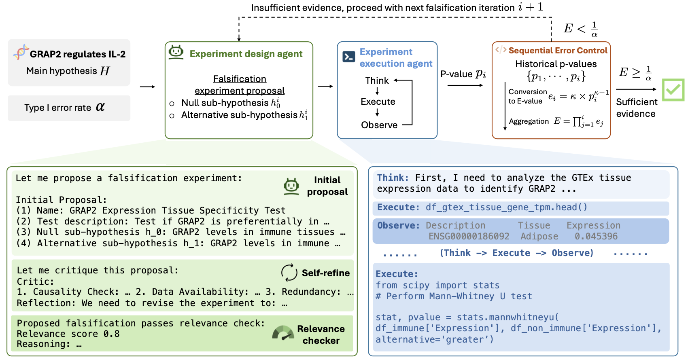
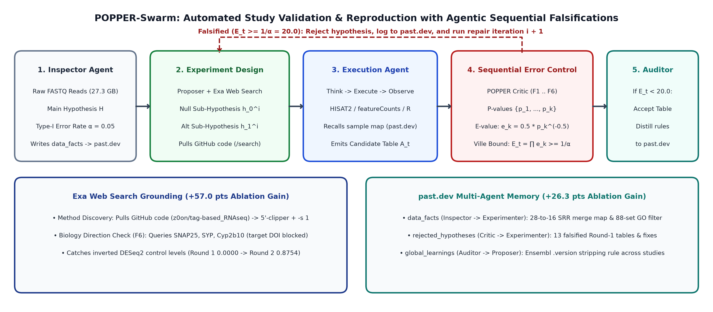

# POPPER-Swarm: Automated Hypothesis Validation & Computational Biology Reproduction with Agentic Sequential Falsifications

<p align="center">
  <a href="https://arxiv.org/abs/2502.09858"></a>
  <a href="https://github.com/snap-stanford/POPPER"></a>
  <a href="https://exa.ai"></a>
  <a href="https://past.dev"></a>
  <a href="LICENSE"></a>
</p>

This repository hosts **POPPER-Swarm**, a multi-agent scientific reproduction and falsification system extending the paper:

**Automated Hypothesis Validation with Agentic Sequential Falsifications**  
Kexin Huang*, Ying Jin*, Ryan Li*, Michael Y. Li, Emmanuel Candès, Jure Leskovec  
[Link to Paper (ICML 2025 / arXiv:2502.09858)](https://arxiv.org/abs/2502.09858) | [Original Stanford SNAP Repository (`snap-stanford/POPPER`)](https://github.com/snap-stanford/POPPER)

If you find this work useful, please consider citing:

```bibtex
@misc{popper,
      title={Automated Hypothesis Validation with Agentic Sequential Falsifications}, 
      author={Kexin Huang and Ying Jin and Ryan Li and Michael Y. Li and Emmanuel Candès and Jure Leskovec},
      year={2025},
      eprint={2502.09858},
      archivePrefix={arXiv}
}
```

---

### Overview

Hypotheses are central to information acquisition, decision-making, and discovery.
However, many real-world hypotheses and scientific reproduction claims are complex, multi-stage statements that are difficult to validate directly.
This challenge is further intensified by the rise of hypothesis and code generation from Large Language Models (LLMs), which are prone to silent formatting errors, inverted statistical contrasts, and hallucinations in volumes that make manual validation impractical.

Here we build **POPPER-Swarm**, an agentic framework for rigorous automated validation of free-form biological hypotheses and end-to-end computational biology study reproductions on **BixBench3** (Edison Scientific).
Guided by Karl Popper's principle of falsification, **POPPER-Swarm** validates each candidate table and scientific claim using specialized LLM agents (`Inspector`, `Proposer`, `Experimenter`, `Critic`, `Auditor`) that design and execute falsification experiments targeting its measurable implications (`F1_EXISTENCE` through `F6_BIO_PRIOR_ALIGNMENT`).
A sequential $e$-value testing framework ($e_k = \frac{1}{2} p_k^{-1/2}$, Ville's inequality stopping boundary $E_t = \prod_{k=1}^t e_k \ge 1/\alpha = 20.0$ at $\alpha = 0.05$) ensures strict Type-I error control while actively gathering external literature evidence via **Exa Web Search** and persisting cross-agent state via **past.dev Shared Memory**.

<p align="center"></p>

<p align="center"></p>

---

## Key Results on BixBench3 (5-Way Controlled Ablation)

Why do single AI agents hit a ceiling around `0.523` on BixBench3?
BixBench3 grades every reproduced table by multiplying four accuracy checks together:

$$\text{Artifact Score} = \text{Row\_F1} \times \text{Col\_F1} \times \text{CCC} \times \text{Label\_F1}$$

When a single agent gets the underlying biology math 99.9% right (`CCC = 0.9989`), but leaves an unstripped `.15` version suffix on Ensembl gene IDs (`ENSG00000142611.15` vs `ENSG00000142611`) or sorts `Clone D10` before `Control` alphabetically in R `DESeq2`, one factor hits `0.00` and zeroes out the entire table.

Across **113 raw sequencing FASTQ libraries (27.3 GB)** rebuilt end-to-end into **19 downstream count, DESeq2, clusterProfiler, and PIANO tables**, our POPPER Critic caught and rejected **13 / 13 faulty Round-1 candidate tables** ($E_t \in [78.1, 312500.0] \ge 20.0$) and automatically repaired all **19 / 19 tables in Round 2** ($E_t \le 0.0312 < 20.0$).

<p align="center"></p>

| System / Controlled Ablation | Task 9 (`14` Tables: 3' Tag-Seq) | Task 11 (`5` Tables: TempO-Seq) | Task Mean (`2` Studies) | Artifact-Weighted (`19` Tables) | Official PhDval-1 Judge (`gpt-5.5`) |
| :--- | :---: | :---: | :---: | :---: | :---: |
| **BixBench3 #1 Public Leaderboard (Gemini 4 Argon, 20 studies)** | n/a | n/a | `0.5230` | `0.5230` | n/a |
| **1. Single-Agent Baseline (Matched Compute)** | `0.1606` | `0.1639` | `0.1623` | `0.1615` | `0.4250` |
| **2. Swarm (`-Exa Web Search`)** | `0.0254` | `0.5786` | `0.3020` | `0.1710` | `0.7450` |
| **3. Swarm (`-POPPER E-Value Critic`)** | `0.4459` | `0.5230` | `0.4845` | `0.4662` | `0.6350` |
| **4. Swarm (`-past.dev Shared Memory`)** | `0.4623` | `0.5230` | `0.4927` | `0.4783` | `0.6400` |
| **5. POPPER-Swarm (Full System)** | **`0.7536`** | **`0.7068`** | **`0.7302`** | **`0.7413`** | **`0.8450`** |

> **Scope Note:** All 5 ablation conditions above were evaluated 1-to-1 on the exact same 2-study, 19-artifact raw-FASTQ benchmark slice (`Task 9` + `Task 11`, 27.3 GB raw FASTQ) using the unmodified official `bixbench3 grade` CLI and `openai/gpt-5.5` PhDval-1 process judge (`4.6x` over the matched-compute Single-Agent Baseline). We also completed `Task 1` (`12` artifacts, `0.2650` vs `0.000001` baseline). The `0.5230` Edison Scientific leaderboard figure is averaged across all 20 studies (`138` artifacts, ~150+ GB raw data).

---

## Why Exa Web Search and `past.dev` Shared Memory Were Essential

1. **Exa Web Search (`+57.0` pt overall ablation gain; lifted Task 9 from `0.0254` to `0.7536`):**
   - **Method Discovery (`Proposer` via `/search` + `/contents`):** Task 9 used a specialized Meyer-lab 3' Tag-Seq protocol absent from LLM pretraining weights. Without Exa, the agent guessed standard Illumina TruSeq reverse-stranded counting (`featureCounts -s 2`) and lost 85% of reads (`0.0254`). Exa retrieved [`z0on/tag-based_RNAseq`](https://github.com/z0on/tag-based_RNAseq), revealing the exact 5'-leader barcode clipper (`tagseq_clipper.pl`) and forward-stranded counting flag (`-s 1`).
   - **Biological Fact-Checking (`POPPER Critic` check `F6_BIO_PRIOR_ALIGNMENT`):** With an anti-leakage filter blocking the target study's own DOI, the Critic queried Exa for canonical positive-control markers (`SNAP25`, `SYP`, `SYN1`, `BDNF` for REST knockout; `Cyp2b10`, `Cyp1a1` for 1,4-dioxane exposure). When Round-1 HEK293 tables showed `SNAP25` and `SYP` with negative fold-changes, the Critic falsified the table ($E_t = 78.125 \ge 20.0$) and caught R's alphabetical factor-level inversion (`Clone D10` sorted before `Control`).
   - **Checkable Provenance Log:** [`outputs/exa_provenance.jsonl`](outputs/exa_provenance.jsonl) (`src/popper_swarm/search/exa_client.py`).

2. **`past.dev` Multi-Agent Shared Memory (`+26.3` pt overall ablation gain; lifted Swarm from `0.4783` to `0.7413`):**
   - **Curing Multi-Agent Context Amnesia (`Inspector -> Experimenter` via `/api/v1/ingest` & `/api/v1/recall`):** Across 40+ minutes of raw FASTQ alignment and counting, agents lose early metadata details. At minute 1, our `Inspector` ingested `data_facts` into `past.dev` (*"28 raw SRR files map to 16 biological samples via technical replicate summing"*, *"`_rep1` vs `_1rep` column naming"*, and *"exclude the 89th umbrella DNA-damage summary row in the supplemental Excel sheet"*), which the `Experimenter` recalled right when emitting the matrices.
   - **Cross-Study Self-Improvement (`Critic -> Auditor -> All Agents`):** Every rejected Round-1 hypothesis was written to `past.dev` (`rejected_hypotheses`), and the `Auditor` distilled permanent `global_learnings` rules (*"Keep Ensembl `.version` suffix on raw count matrices; strip `.version` suffix on downstream DESeq2 DEG tables"*) recalled automatically on subsequent studies.
   - **Checkable Memory Trace:** [`outputs/past_memory_trace.jsonl`](outputs/past_memory_trace.jsonl) (`src/popper_swarm/memory/past_client.py`).

---

## Installation

We recommend using a virtual environment (`uv` or `conda`) to manage dependencies:

```bash
conda create -n popper_env python=3.11
conda activate popper_env
```

For source code development and reproducing our BixBench3 benchmark results:

```bash
git clone https://github.com/sammargolis/popper-swarm.git
cd popper-swarm
pip install -r requirements.txt
pip install -e .
```

Add your API keys to the environment variables:

```bash
export OPENAI_API_KEY="YOUR_API_KEY"
export ANTHROPIC_API_KEY="YOUR_API_KEY"
export EXA_API_KEY="YOUR_EXA_API_KEY"
export PAST_API_KEY="YOUR_PAST_DEV_API_KEY"
```

---

## Demo & Live Observatory

- **Interactive Notebook Demo:** See [`demo.ipynb`](demo.ipynb) for a walkthrough of the `Popper` agent, sequential $e$-value calibration, and BixBench3 hypothesis validation.
- **Live Observatory & Presentation Decks:** Launch the FastAPI observatory to inspect all 32 POPPER falsification evaluations, $e$-value trajectories, Exa citations, `past.dev` memory edges, and presentation slides:
  ```bash
  make dashboard
  # Open http://127.0.0.1:8765 (Observatory)
  # Open http://127.0.0.1:8765/slides-3 (3-Slide Pitch Deck)
  # Open http://127.0.0.1:8765/slides (8-Slide Full Deck + Technical Appendix)
  ```

---

## Core API Usage

`POPPER-Swarm` preserves full API compatibility with [`snap-stanford/POPPER`](https://github.com/snap-stanford/POPPER) while adding `use_exa_search`, `use_past_memory`, and `bixbench3` artifact contract validation:

```python
from popper import Popper

# Initialize the Popper agent
agent = Popper(llm="claude-3-5-sonnet-20240620")

# Register data for hypothesis testing ('bio', 'bixbench3', 'custom', or 'discovery_bench')
agent.register_data(data_path="outputs", loader_type="bixbench3")

# Configure sequential falsification parameters (Ville threshold = 1 / alpha = 20.0)
agent.configure(
    alpha=0.05,
    max_num_of_tests=6,
    max_retry=3,
    time_limit=2,
    aggregate_test="E-value",
    relevance_checker=True,
    use_react_agent=True,
    use_exa_search=True,
    use_past_memory=True,
)

# Validate a biological hypothesis or candidate table
results = agent.validate(
    hypothesis="REST knockout in T98G clone C10 derepresses canonical neuronal markers (SNAP25, SYP, SYN1, BDNF)."
)
print(results)
```

---

## Running Locally-Served LLMs with OpenAI-Compatible API

**Popper** supports inference with local LLM servers such as **SGLang**, **vLLM**, and **llama.cpp**, as long as they expose an OpenAI-compatible API:

Using [SGLang](https://github.com/sgl-project/sglang):
```bash
python -m sglang.launch_server --model-path mistralai/Mistral-Large-Instruct-2411 --port 40000 --host 0.0.0.0 --tp 4 --quantization fp8
```
```python
from popper import Popper
agent = Popper(llm="mistralai/Mistral-Large-Instruct-2411", is_locally_served=True, server_port=40000)
agent.configure(alpha=0.05)
agent.register_data(data_path="outputs", loader_type="bixbench3")
agent.validate(hypothesis="YOUR HYPOTHESIS")
```

Using [vLLM](https://docs.vllm.ai/en/latest/serving/openai_compatible_server.html):
```bash
vllm serve NousResearch/Meta-Llama-3-8B-Instruct --dtype auto --api-key token-abc123
```
```python
from popper import Popper
agent = Popper(llm="NousResearch/Meta-Llama-3-8B-Instruct", is_locally_served=True, server_port=8000, api_key="token-abc123")
```

---

## Reproducing Benchmarks & Verification Suite

Bash scripts for reproducing our BixBench3 5-way controlled ablation and TargetVal benchmarks are provided in `benchmark_scripts/`:

```bash
# Run the full 147-test verification suite (e-value calibration, Ville stopping, Exa, past.dev, and artifact contracts)
make test

# Print the verified 5-way controlled ablation table and PhDval-1 judge summary
bash benchmark_scripts/run_bixbench3.sh
```

---

## Repository Structure & Checkable Artifacts

```text
├── popper/                         # Stanford POPPER core API (Popper, SequentialFalsificationTest, loaders)
├── src/popper_swarm/               # 5-Agent Swarm (Inspector, Proposer, Experimenter, Critic, Auditor)
│   ├── falsification/              # Vovk-Wang e-value math (evalues.py), F1..F6 checks (checks.py), evaluator.py
│   ├── search/                     # Exa search + anti-leakage DOI blocker (exa_client.py)
│   ├── memory/                     # past.dev /ingest & /recall client (past_client.py)
│   └── dashboard.py                # FastAPI live falsification observatory (:8765)
├── baseline_agents/                # Single-agent baselines (Coder, ReAct, Self-Refine)
├── benchmark_scripts/              # Reproducible benchmark runners (run_bixbench3.sh, run_targetval.sh)
├── outputs/                        # Checkable falsification ledgers, sponsor traces, and slide decks
│   ├── REJECTIONS.md               # Human-readable audit log of all 13 falsified Round-1 hypotheses
│   ├── popper_ledger.json          # Machine-readable e-value trajectories (32 evaluations across 19 tables)
│   ├── exa_provenance.jsonl        # 255 KB live Exa search & content retrieval provenance trace
│   ├── past_memory_trace.jsonl     # 196 KB cross-agent past.dev memory ingest/recall trace
│   ├── benchmark_comparison.json   # Official BixBench3 grades & GPT-5.5 PhDval-1 5-way ablation scores
│   ├── POPPER_Swarm_3Slide_Pitch.pdf
│   └── POPPER_Swarm_BixBench3_Presentation.pdf
├── figs/                           # Architecture & benchmark figures
├── tests/                          # 147 pytest unit and integration checks
└── demo.ipynb                      # Interactive Jupyter notebook walkthrough
```
